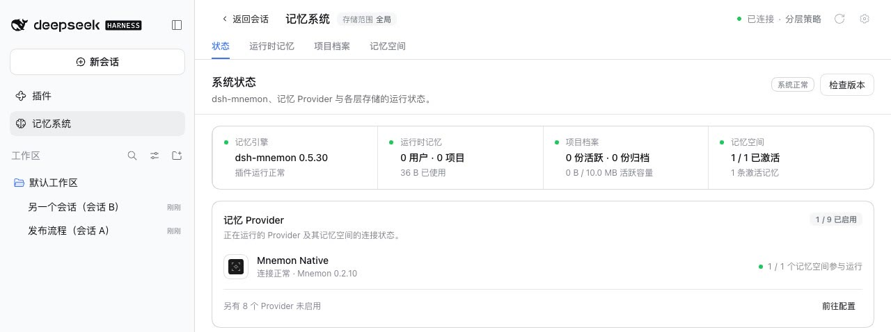
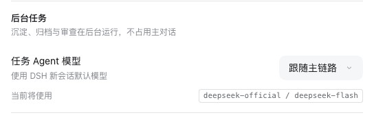
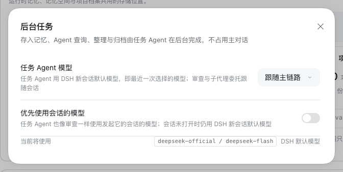
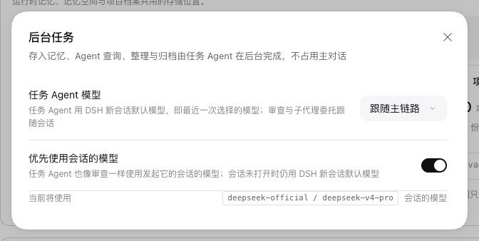
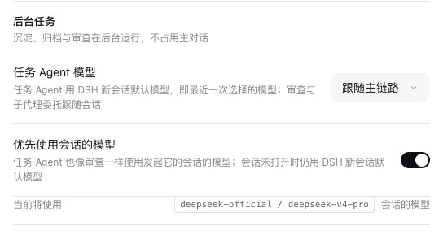

# 可跟随会话的任务 Agent — PR #354

[English](./README.md) | [验证记录](./verification.json)

PR #354 让存入记忆、Agent 查询、整理与归档背后的任务 Agent 使用发起该工作的会话的模型，并把任务 Agent 模型放到记忆系统的状态页上。最初提交的版本有三个问题：
- 改变了所有 Profile 中 `taskAgentModel: inherit` 的含义；
- 发起的会话没有打开时，会转而使用另一个已打开会话的模型；
- 状态页卡片只保留首次出现时读到的设置。

维护者的调整保留作者的提交与这项功能，改为由一个默认关闭的开关控制。

版本：基线 main `c00e6d7a`；作者提交 `6e6a4921` 与 `3977b974`；合入 main 的 `1fb83599`；调整 `4a40ace5`。运行于 2026-10-17（Asia/Shanghai）：
- macOS 15.6 arm64，Node 24.19.0，Mnemon CLI 0.2.10；
- headless Chrome，1280×800，zh-CN，浅色；
- DSH 0.2.0-rc.2（npm `latest` 与 `next`）和 0.2.1-alpha.2，经由 `scripts/serve-e2e.mjs`。

## DSH 如何处理模型选择

DSH 对模型选择有两种处理（两个宿主相同）：
- 在某个会话中选择的模型，会用于该会话的下一次请求；DSH 同时把它保存为新会话默认模型（会话控制器中的 `agentDefaultModel.saveSelection`）。任务 Agent 使用这个默认模型，因此运行在最近一次在任意会话中选择的模型上。
- 委派出去的子 Agent 沿用父 Agent 的路由：父 Agent 最近一次请求的 provider、模型与推理等级，第一次请求之前则用创建时的路由。因此空闲审查以及会话发起的其他委派，始终跟随该会话。

所以多数情况下，任务 Agent 本来就运行在其会话的模型上。两者不一致的情形是：之后另一个会话选择了不同的模型，例如一个会话用快速模型、另一个用更强的模型。此时在第一个会话中存入记忆，会运行在第二个会话的模型上，而第一个会话的审查仍使用第一个会话的模型。

## 改动

- **优先使用会话的模型**位于**任务 Agent 模型 → 跟随主链路**下，是一个开关（`taskAgentModel.followConversation`），默认关闭。它让任务 Agent 使用 DSH 给该会话自身委派所用的路由，前提是该会话处于打开状态，从而与审查一致。会话未打开，或调用方没有会话时，仍使用 DSH 默认模型。开关关闭时，行为与之前完全相同。
- 它是一个配置键，而不是第三种模式。v0.5.30 的 schema 会保留不认识的键，其解析器仍按 `inherit` 读取，因此降级后照常工作；未知的模式则会导致加载失败。
- 只认发起任务的那个会话。最初的版本会转而使用恰好处于打开状态的其他会话。
- 状态页的**后台任务**说明任务 Agent 使用的模型及其来源。它的齿轮打开与分层策略页面相同的选项，因此使用其他策略的 Profile 也能修改。两个页面都读取已保存的设置，在一处修改，另一处立即显示。齿轮打开之前，页面只读取路由。
- 保留作者对对话框的修复：在对话框上方打开的菜单自行处理 Esc 与 Tab。

对调整的独立审查又发现了六个问题，现在各有测试覆盖：
- 状态页最初的文案也把审查包括在内；
- 放弃一个尚未写入的指定模型时，会关掉开关；
- 指定模型时，**重新读取**只读了路由；
- 状态页每次打开都读取完整的模型目录；
- 没有 DSH 默认模型时，或页面尚未读到设置时，显示的路由可能与 Host 不同；
- 开关没有带上推理等级。

最初版本自己的截图展示了它放在状态页上的编辑器，现在由说明路由的一行与齿轮取代：[卡片](./status-background-tasks-zh.png)、[指定模型](./status-background-tasks-fixed-model-zh.png)与[其 Provider 列表](./status-background-tasks-provider-zh.png)。

## 运行过程

两个宿主上运行相同的步骤。本地回环的模型替身（[harness/stub.mjs](./harness/stub.mjs)）记录每个请求指定的模型；它就是夹具自带的替身加上存入记忆的脚本，通过 `--live-model` 与测试密钥接入。

1. 会话 A 选择 DeepSeek-V4-Pro，得到一条回复。
2. 新建会话 B，选择 DeepSeek-V4.1-Flash，得到一条回复。
3. 回到 A，对其回复执行**存入记忆 → 交给任务 Agent**。
4. 在本分支上：打开状态页及其齿轮，打开开关，A 再得到一条回复并第二次存入记忆；最后查看分层策略页面。

| | A 的回复 | B 的回复 | A 存入记忆的任务 |
|---|---|---|---|
| main，DSH 0.2.0-rc.2 | `deepseek-v4-pro` | `deepseek-flash` | `deepseek-flash` |
| 本分支，开关关闭，两个宿主 | `deepseek-v4-pro` | `deepseek-flash` | `deepseek-flash` |
| 本分支，开关打开，两个宿主 | `deepseek-v4-pro` | | `deepseek-v4-pro` |

开关关闭时，本分支与 main 相同：A 的任务运行在 B 的模型上，即 DSH 默认模型。开关打开后，任务运行在 A 自己的模型上。开关保存为 `taskAgentModel: { mode: inherit, followConversation: true }`。所有步骤都没有浏览器控制台错误。

main 的状态页没有后台任务一栏，分层策略页面也没有这个开关：

| main 的状态页 | main 的分层策略页面 |
|---|---|
|  |  |

在本分支上，状态页说明路由及其来源，齿轮打开选项：

| 选项，开关关闭 | 开关打开：A 自己的模型 |
|---|---|
|  |  |

| 打开开关后的状态页 | 分层策略页面读取同一设置 |
|---|---|
|  |  |

## 测试

- **Host：**
  - 继承的路由除非跟随会话，否则保持 DSH 默认模型。
  - 开关打开后，运行时维护和从该会话发起的页面任务都使用它的路由，推理等级也在内；尚未运行过的会话与 DSH 的委派一样使用创建时的路由。
  - 会话未打开、调用方没有会话，或请求头只有一半时，保持默认模型。
  - 无论开关如何，模型目录都会报告会话的路由与继承的路由。
- **配置：**开关未设置时关闭，对指定模型的路由不起作用，并且必须是布尔值。
- **状态页：**
  - 说明的路由及其来源、齿轮与对话框、开关的打开与关闭、在对话框中选择指定模型。
  - 在其他页面所做的修改会立即显示。
  - 放弃指定模型时保留开关。
  - 齿轮打开之前只读取路由；指定模型时，**重新读取**会读取完整目录。
  - 没有 DSH 默认模型时，以及读到设置之前，显示的路由都正确。
  - 模型目录读取失败时会说明原因；没有设置权限时不显示齿轮。
- **分层策略页面：**带着自己的会话发起请求，且只在开关打开时跟随会话。
- **在最初的版本（`1fb83599`）上，其中 14 项失败：**12 项是新写或改写的用例，另外 2 项是旧的目录用例，现在要求返回继承的路由。例如，从未打开的会话发起的任务拿到了已打开会话的 `ai / space-bunny`；在其他页面保存的指定模型始终没有出现在状态页上。审查对应的 8 项用例在审查前的调整（`1ac2e75d`）上同样失败。

## 校验

调整后 `pnpm run verify`（Node 24.19.0，pnpm 11.25.0）通过：
- 文档、类型检查与确定性构建；
- 所有插件的构建、类型检查与测试；
- 主包测试：2,025 项通过，6 项跳过；
- Headless 激活与旧设置导入；
- 发布包内容：59 个文件，解包后 1,990,405 字节，低于 2,500,000 字节上限；
- publint 与 attw。

[verification.json](./verification.json) 记录了每次运行的请求、显示的路由与步骤。
