# Git sync finds its token whatever Git configures, under a user name each host takes

[简体中文](./README.zh-CN.md) | **English**

Issue [#408](https://github.com/omdsh-dev/dsh-mnemon/issues/408) and its comment. Tested on branch `claude/fix-408-git-credential-username`, written on main `2143a1ed` (v0.5.32), 2026-10-19 to 2026-10-20 (Asia/Shanghai), Node 24.19.0, pnpm 10.13.1 and Git 2.50.1 (Apple Git-155), against the pinned DSH 0.2.1-rc.2 and an installed DSH 0.2.0-rc.2. No account, token or network remote was used: every Git command ran against local repositories or a loopback HTTPS remote with made-up tokens, under a Git configuration the check wrote itself (`GIT_CONFIG_GLOBAL`, `GIT_CONFIG_NOSYSTEM=1`), so the machine's own configuration was never read.

## What was wrong

Git sync hands a token to Git through a credential store that exists for one command: a `0600` file holding `https://x-access-token:<token>@<host>`, and arguments that clear the helper list and add `store --file=<file>`. Git found nothing in it in two cases, and a third case broke on the host's side:

- **A user name configured for the host.** Git looks a credential up under the user name it has for the address, and takes one from `credential.username` or `credential.<url>.username` when the address names none. Git Credential Manager setups carry `credential.https://github.com.username`, as the reporter's did. The store holds `x-access-token`, so nothing matched, Git fell back to a prompt, `GIT_TERMINAL_PROMPT=0` refused it, and `could not read Password` was classified as an authentication failure: the page said "Needs credentials; sign in with GitHub or add an access token" while the account was signed in, and signing in again changed nothing.
- **`credential.useHttpPath`.** With it on, Git adds the repository's path to the lookup, and an entry that names the host alone no longer matches. Git Credential Manager's installer sets `credential.https://dev.azure.com.useHttpPath = true` ([source](https://github.com/git-ecosystem/git-credential-manager/blob/main/src/Microsoft.AzureRepos/AzureReposHostProvider.cs), `ConfigureAsync`).
- **`x-access-token` is GitHub's user name for a token.** The comment measured Gitee with a valid token: the account name and `oauth2` work, `x-access-token` gets `The token username invalid` and HTTP 403. HTTPS sync with a token could never work there, and the page again asked for a token that was given.

All three ended in a message that sent the user to sign in or add a token. The store's host was also written as `new URL(address).host`, lowercased and without a default port, while Git compares the host as the address writes it: `https://GitHub.com/...` or `https://host:443/...` never matched either.

## What changed

**The user name.** The store holds the user name the address names, else `x-access-token` for `github.com` and `oauth2` for every other host (`src/host/git-sync.ts`, `credentialTarget`). The host is kept exactly as the address writes it, and the token is percent-encoded, which Git decodes back; a token made of letters, digits, `-`, `_`, `.` and `~`, as GitHub's, GitLab's, Gitee's and Gitea's are, is written byte for byte as before.

**The lookup.** Git must look the token up under that name, whatever the machine configures:

- Git 2.26 and later are given `-c credential.username=<name>`. From 2.26 on, the last `credential.username` Git reads wins, and the command line is read after every configuration file ([82eb2498](https://code.googlesource.com/git/+/82eb249853868582d8ba65e3afc5a7dcaeb620ea%5E%21/), "credential: use the last matching username in the config"). Credential sections are applied in the order they are read whatever their URL pattern, so a more specific pattern does not win: the tests include `credential.https://github.com/<owner>.username` and one for a single repository, an included file, the system file, `GIT_CONFIG_PARAMETERS` and `GIT_CONFIG_COUNT`.
- An older Git (the channel supports 2.20 and later) kept the first configured user name, so a name on the command line would lose to a global one there. It gets the name in the address instead, `https://<name>@<host>/...`, which every Git takes before any configured name ([gitcredentials](https://git-scm.com/docs/gitcredentials): `username` is "a default username, if one is not provided in the URL").
- An address that names its user goes to Git as written, in every version.
- Every authenticated command also gets `-c credential.useHttpPath=false`, as the store names the host alone.

The Git version is the one the channel already reads before every operation (`gitStatus`). Nothing else changes: `ls-remote`, `fetch` and `push` take the same arguments otherwise, the mirror's `mnemon.origin` keeps the configured address, and Git writes `FETCH_HEAD` without a user part.

**Why not the user name in the address on every Git.** That is the mechanism Git documents as taking precedence. Traced against the loopback remote, an address with a user name makes Git, through curl, offer that name once with an empty password before it asks the store; a command-line name keeps the sequence a working setup makes today:

| How the name reaches Git | Requests one `ls-remote` makes (user:password) |
|---|---|
| Nothing pinned, the issue's configuration (main) | none, then Git gives up: `could not read Password for 'https://alice@…'` |
| `-c credential.username=oauth2` (Git 2.26 and later, this change) | none → `oauth2:<token>` → `oauth2:<token>` |
| `https://oauth2@host/...` (older Git, this change) | none → `oauth2:<empty>` → `oauth2:<token>` → `oauth2:<token>` |

The empty-password request is answered 401 by the hosts above, which then get the token, but it is one more request on every command, and a host that answered it with 403 would refuse a sync that works today. The address form is kept for the Git versions where nothing else wins. The issue's own patch, `-c credential.username=x-access-token`, is the Git 2.26 form for github.com, which the reporter verified against real GitHub with `ls-remote`, `fetch` and `push --dry-run`.

**A user name in the address.** `src/host/sync-rules.ts`, shared by the form and the Host, accepts an HTTPS address whose user part is a user name: letters, digits, `.`, `_`, `~`, `+`, `-` or percent-escapes, up to 100 characters. It still refuses a password (`user:secret@`), an empty user part, a second `@`, and a user part shaped like a token: the prefixes GitHub (`ghp_`, `gho_`, `ghu_`, `ghs_`, `ghr_`, `github_pat_`) and GitLab (`glpat-`) give their tokens, and 32 or more letters and digits in a row, which Gitee's, Gitea's, Azure DevOps' and older GitHub tokens are. The form's refusal now reads "Only a user name may go in the address; enter the token under Access token" (地址里只能写用户名，令牌请填在“访问令牌”里).

**The message.** When the Host offered a credential and the host refused it, the repository row, a sync, an automatic sync and the two dialogs now say so: "GitHub rejected the credential; sign in again or check its access to this repository" for github.com, and "The host rejected the credential; check the token, or put the user name it expects in the address" for any other HTTPS host. The client decides from `credentialSource`, which the status already carries and which comes from the same resolution each command uses. With no credential the old text stays, as does every SSH, local, not-found, network and timeout text. Git's own words are not shown: the cause is named, and the line stays short.

## User names hosts take with a token

| Host | User name with a token | Source |
|---|---|---|
| github.com | `x-access-token`, unchanged; the GitHub sign-in's grant works under it | [GitHub: installation tokens over HTTP](https://docs.github.com/en/apps/creating-github-apps/authenticating-with-a-github-app/authenticating-as-a-github-app-installation); the reporter's check with `-c credential.username=x-access-token` |
| GitLab | Any non-blank name for personal, project and group tokens; `oauth2` recommended for OAuth tokens | [Personal access tokens](https://docs.gitlab.com/user/profile/personal_access_tokens/), [OAuth 2.0](https://docs.gitlab.com/api/oauth2/) |
| Gitee | The account name or `oauth2`; `x-access-token` is refused with HTTP 403 | The issue comment's measurements on 0.5.32; no Gitee documentation found |
| Gitea | Not checked: a password that is a token identifies the user | [services/auth/basic.go](https://github.com/go-gitea/gitea/blob/main/services/auth/basic.go) |
| Forgejo | Its deployments document the account name with the token as password; it derives from Gitea, whose check ignores the name, but its current code was not checked here | — |
| Azure DevOps | Not checked: "the username can be empty" | [Use personal access tokens](https://learn.microsoft.com/en-us/azure/devops/organizations/accounts/use-personal-access-tokens-to-authenticate) |
| Bitbucket Cloud | `x-token-auth` (access and API tokens), or the Bitbucket user name for API tokens; `oauth2` is not listed, so the address names the user | [Access tokens](https://support.atlassian.com/bitbucket-cloud/docs/using-access-tokens/), [API tokens](https://support.atlassian.com/bitbucket-cloud/docs/using-api-tokens/) |
| AWS CodeCommit | The user name IAM generates for Git credentials | [Git credentials](https://docs.aws.amazon.com/codecommit/latest/userguide/setting-up-gc.html) |

So the default for every host other than github.com is `oauth2`: Gitee requires it or the account name, GitLab recommends it for OAuth tokens and takes it for the others, and Gitea and Azure DevOps ignore the name. `x-access-token`, which those three also ignore or accept, is what Gitee refuses. A host that wants a particular name, such as Bitbucket, gets it from the address, which is how its own documentation writes the clone address (`https://x-token-auth@bitbucket.org/{workspace}/{repository}.git`).

## Before and after

### Offline: what `git credential fill` finds with the arguments the channel hands Git

[`harness/credential-lookup.probe.ts`](./harness/credential-lookup.probe.ts) answers the status check's `ls-remote` with `git credential fill` on the very argument list the channel built, while the one-command store exists, then syncs through a loopback HTTPS remote, and prints what the page says. Run once on this branch and once with main's `git-sync.ts`, `sync-rules.ts`, `sync-view.ts`, `MnemonSyncSection.tsx`, `MnemonSyncDialogs.tsx` and `locales.ts`:

| Case | main | This change |
|---|---|---|
| `credential.https://github.com.username = alice` (the issue) | `could not read Password for 'https://alice@github.com'` | `username=x-access-token password=<token>` |
| `credential.https://github.com/octocat.username = alice` | `could not read Password for 'https://alice@github.com'` | `username=x-access-token password=<token>` |
| `credential.username = alice` | `could not read Password for 'https://alice@github.com'` | `username=x-access-token password=<token>` |
| `credential.https://dev.azure.com.useHttpPath = true` | `could not read Username for 'https://dev.azure.com/contoso/project/_git/memory'` | `username=oauth2 password=<token>` |
| gitee.com, no configuration | `username=x-access-token` (which Gitee refuses) | `username=oauth2 password=<token>` |
| The address writes `GitHub.com:443` | `could not read Username for 'https://GitHub.com:443'` | `host=GitHub.com:443 username=x-access-token password=<token>` |
| HTTPS remote taking the token under any name; `alice` configured for it | status: auth, `could not read Password for 'https://alice@127.0.0.1:…'` | reachable; push published |
| HTTPS remote refusing `x-access-token` and taking `oauth2`, as Gitee does | status: auth, `remote: This host takes no token under that user name` … `error: 403` | reachable; push published |
| HTTPS remote wanting `x-token-auth`, named in the address | refused: `sync repository must not embed credentials` | reachable; push published |
| The page, github.com, credential offered | Needs credentials; sign in with GitHub or add an access token | GitHub rejected the credential; sign in again or check its access to this repository |
| The page, another host, credential offered | Needs credentials; add an access token | The host rejected the credential; check the token, or put the user name it expects in the address |
| The page, no credential (both hosts) | Needs credentials … | unchanged |

### In the WebUI

The real WebUI (`scripts/serve-e2e.mjs`) on DSH 0.2.1-rc.2, with three loopback remotes from [`scripts/fixtures/git-https-remote.mjs`](../../../scripts/fixtures/git-https-remote.mjs), the WebUI's Git given `GIT_SSL_CAINFO` for their certificates and a configuration that names `alice` for the first one. The same steps ran on main's build and on this branch's, in Chinese and in English; the screenshots show the sync section of the dsh-mnemon page under Plugins.

Headless Chrome at 1280×900, light. Under **Plugins → dsh-mnemon**, switch **Git sync** on, choose **Repository address**, enter the first remote's address and a token and click **Connect**. Then, each time through **Change** and **Save**: the second remote with the token; the same address with a wrong token; the third remote's address with `x-token-auth@` and the token, followed by **Sync now**; the same address with `x-token-auth:secret@`, which the form refuses, and **Cancel**. The baseline is the same steps on a build with main's six modules.

The first remote takes the token under any name; `alice` is configured for it, and a valid token is entered:

| main | This change |
|---|---|
| 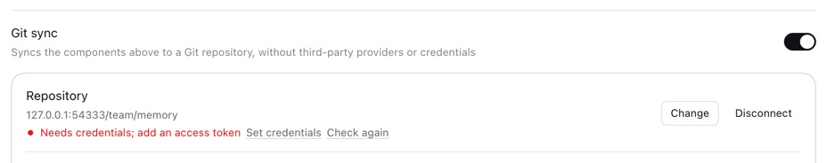 | 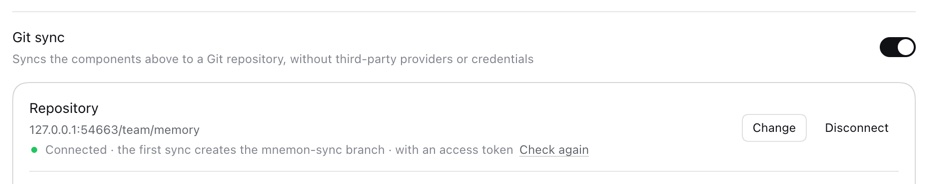 |
| 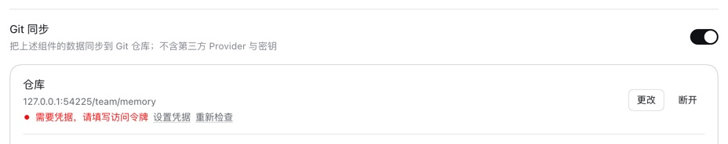 | 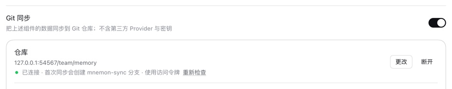 |

The second remote refuses `x-access-token` and takes `oauth2`. With a valid token main says "Needs credentials; add an access token" (the remote saw `x-access-token` and answered 403) and this branch connects; with a wrong token:

| main | This change |
|---|---|
| 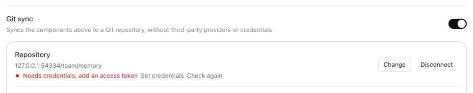 | 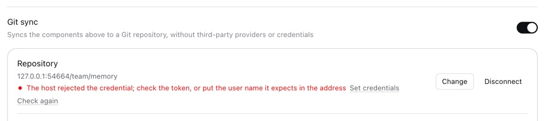 |
|  | 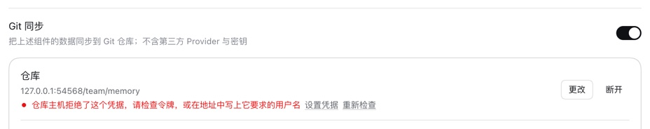 |

The third remote wants `x-token-auth`, written into the address:

| main | This change |
|---|---|
| 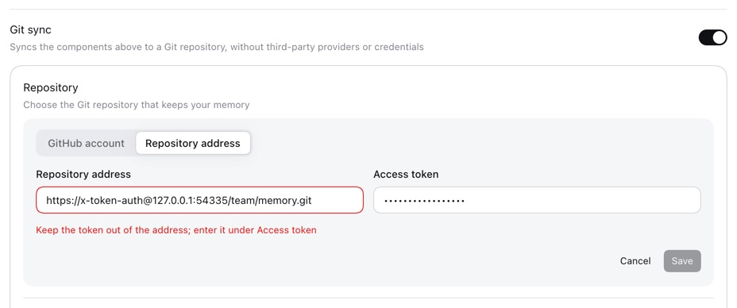 | 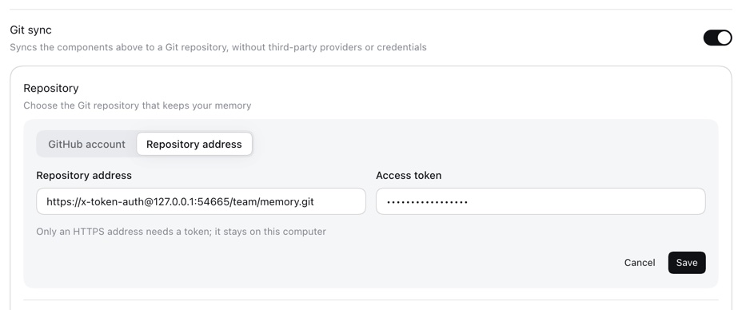 |
| 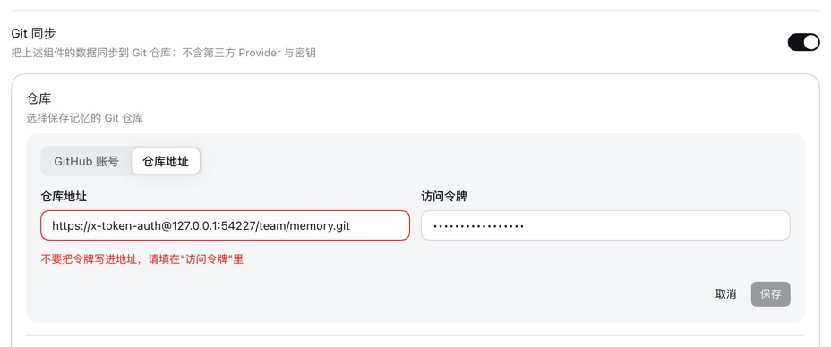 | 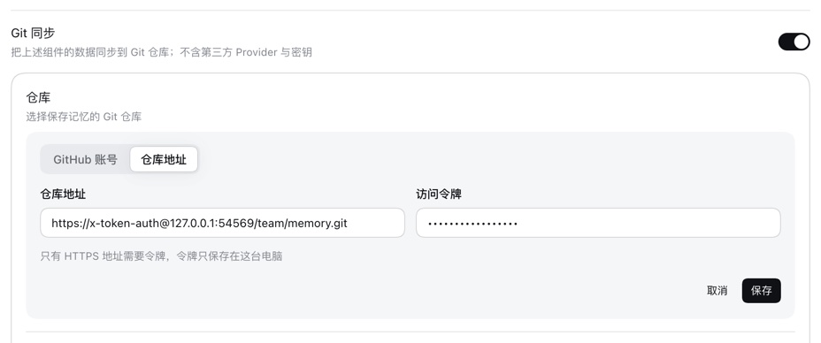 |

On this branch that address connected and **Sync now** published to it. A password in the address is still refused, with the new words:

| English | 中文 |
|---|---|
| 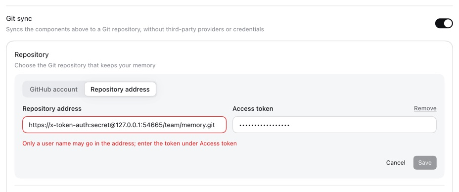 | 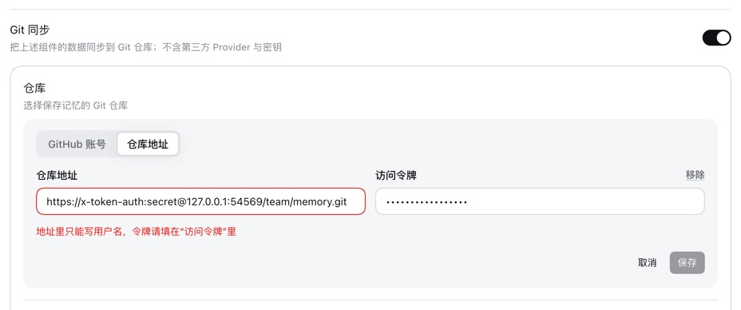 |

What the remotes saw on this branch: the first only `oauth2:<token>` (200), the second `oauth2:<token>` (200, then 401 for the wrong token), the third `x-token-auth` with an empty password (401) and then with the token (200), the request an address that names its user makes. On main: nothing authenticated reached the first, and the second saw `x-access-token:<token>` (403). The same branch steps on DSH 0.2.0-rc.2 gave the same lines and messages. No browser console errors in any run.

### The tests on main's modules

The new and changed tests, run with main's six modules checked out: 15 of 65 fail, each on what this change fixes (the credential spec's lookups, the HTTPS syncs, the address rules on both sides, the form's copy, the refusal message), and the rest pass. `reports a credential the host refuses as an authentication failure with a credential offered` passes on main too: it pins the Host's classification the page relies on.

## Compatibility

- **Stored data and settings.** No key changes: `state/sync-git.json` keeps `repoUrl` and `token`, and a configuration saved before reads the same. What changes is which addresses are accepted: one with a user name is now valid. An earlier dsh-mnemon reading such an address refuses the whole file (`sync repository must not embed credentials`), so a user who saved one and goes back to an earlier version, or shares the data directory with one, has to remove the name first; the guide says so.
- **What existing users see.** On github.com nothing changes but the cases that failed: the user name is still `x-access-token`, and on Git 2.26 or later the requests are the same. On other hosts the user name becomes `oauth2`: GitLab, Gitea and Azure DevOps accepted `x-access-token` and accept `oauth2`, and Gitee, which refused it, now syncs. An address with mixed case or an explicit port now matches its stored credential. The page says "rejected" only when a credential was offered and refused.
- **Mirror and process arguments.** The token reaches only the one-command store. The user name the default adds is in the command's arguments on Git before 2.26 only, and Git writes it nowhere: the test scans both storage roots after a real HTTPS sync and finds neither the token outside `sync-git.json` nor `oauth2` anywhere, `FETCH_HEAD` and the mirror's config included.
- **`url.<base>.insteadOf`.** On Git 2.26 and later the address Git is given is unchanged, so rewrite rules apply as before. On an older Git a rule written for `https://<host>/` no longer matches once the default name is in the address.
- **Version skew.** Starter only: the Host and the page ship in the same package, and no plugin changes. `credentialTarget` is a new export of `src/host/git-sync.ts`, which no public entry exposes; the client's message helpers gained an optional last parameter, and `MnemonKey` two keys.
- **Public SDK, RPC and tools.** No export of any public entry, RPC name, stored key, tool or tool description changes.

## Verification

| Check | Result |
|---|---|
| `pnpm exec vitest run tests/git-sync-credentials.spec.mjs` | 10 passed: 7 offline (`git credential fill` over 14 host and configuration pairs and four more places Git reads configuration from, the sign-in's grant, an address that names its user, host case and port, the Git 2.25 and 2.26 forms, the user name per host), 3 over HTTPS (a sync past a configured name and a host that refuses `x-access-token`, a refused token, a name in the address) |
| Client, rules and configuration tests (`tests/client-sync.spec.tsx`, `tests/sync-rules.spec.ts`, `tests/sync-config.spec.ts`, `tests/client-presentation.spec.ts`) | 60 passed |
| The same new tests on main's modules | 15 of 65 failed, as listed above |
| `pnpm exec vitest run tests/git-sync.spec.ts tests/sync-rpc.spec.ts tests/auto-backup.spec.ts tests/github-auth.spec.ts` | 107 passed |
| `pnpm run e2e:sync` on DSH 0.2.1-rc.2 | 64 of 64 |
| `MNEMON_E2E_DSH=…/dsh-0.2.0-rc.2/… node scripts/verify-sync-git.mjs` | 64 of 64 |
| WebUI: main and this branch, Chinese and English, on DSH 0.2.1-rc.2; this branch also on DSH 0.2.0-rc.2 and on a separately installed 0.2.1-rc.2 | as above |
| `pnpm run verify` | Passed: 5,041 local links and 371 anchors; root tests 2,134 passed and 7 skipped in 154 files; the 17 plugin suites 597 passed and 3 skipped; Headless activation; package contents, 66 files |
| `MNEMON_CLI_PATH=/nonexistent/mnemon MNEMON_PLUGIN_VERIFY_CONCURRENCY=1 pnpm run verify:plugins` | Passed: 17 independent plugin repositories and 18 packed artifacts |
| `DSH_HOST_ROOT=<prefix>/lib/node_modules/@deepseek-ai/dsh pnpm run test:installed-dsh`, DSH 0.2.0-rc.2 | 2,131 passed and 10 skipped in 154 files; the specs of DSH 0.2.1 behavior skip |

```sh
pnpm install --frozen-lockfile
pnpm build && pnpm --workspace-concurrency=4 -r build
# Git reads a configuration the check controls, never the machine's.
export GIT_CONFIG_GLOBAL=<empty file> GIT_CONFIG_NOSYSTEM=1
pnpm exec vitest run tests/git-sync-credentials.spec.mjs tests/client-sync.spec.tsx tests/sync-rules.spec.ts tests/sync-config.spec.ts tests/client-presentation.spec.ts
pnpm exec vitest run tests/git-sync.spec.ts tests/sync-rpc.spec.ts tests/auto-backup.spec.ts tests/github-auth.spec.ts
node scripts/verify-sync-git.mjs
MNEMON_E2E_DSH=<prefix>/lib/node_modules/@deepseek-ai/dsh/lib/bin.js node scripts/verify-sync-git.mjs   # DSH 0.2.0-rc.2
pnpm run verify
MNEMON_CLI_PATH=/nonexistent/mnemon MNEMON_PLUGIN_VERIFY_CONCURRENCY=1 pnpm run verify:plugins
DSH_HOST_ROOT=<prefix>/lib/node_modules/@deepseek-ai/dsh pnpm run test:installed-dsh   # DSH 0.2.0-rc.2
# The probe, on this branch and with main's modules checked out:
cp docs/pr-assets/issue-408-git-credential-username/harness/credential-lookup.probe.ts tests/credential-lookup.spec.ts
pnpm exec vitest run tests/credential-lookup.spec.ts
for file in src/host/git-sync.ts src/host/sync-rules.ts src/client/sync-view.ts src/client/MnemonSyncSection.tsx src/client/MnemonSyncDialogs.tsx src/client/locales.ts; do git show origin/main:$file > $file; done
pnpm exec vitest run tests/credential-lookup.spec.ts
git checkout -- src && rm tests/credential-lookup.spec.ts
# A remote to try by hand; give the WebUI's Git the certificate it prints:
node scripts/fixtures/git-https-remote.mjs --account oauth2:<made-up token> --refuse x-access-token
```

## Limits

- No Git older than 2.26 was available here. Its form is checked by the arguments the channel builds for a reported `git version 2.25.1`, and by Git's own history for which name wins; the address form itself was checked against the loopback remote on Git 2.50.
- No real host was contacted. The loopback remote answers as its policy says; the per-host table rests on each host's documentation, Gitea's source and the comment's Gitee measurements. A host that answered an empty password with 403 would refuse an address that names its user, which is the request every such Git remote makes.
- GitHub still answers "not found" for a private repository a credential cannot reach, and the not-found text still mentions a sign-in or a token; only the authentication case changed, as the issue asked.
- Git's stderr stays out of the page; the Host's error text, with the token masked, still carries it for anything the page cannot name.
