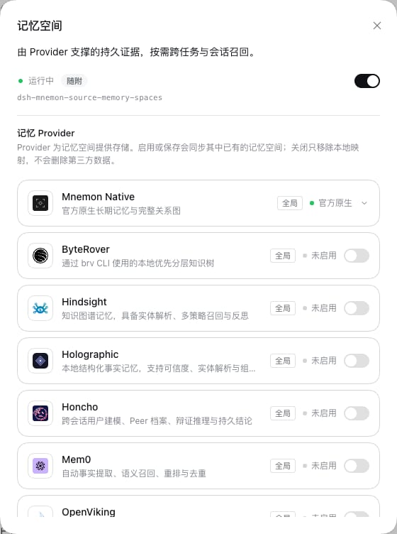
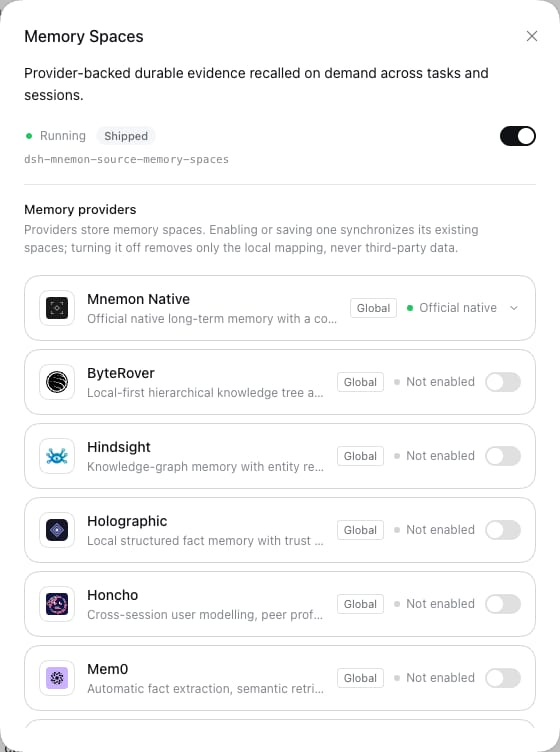
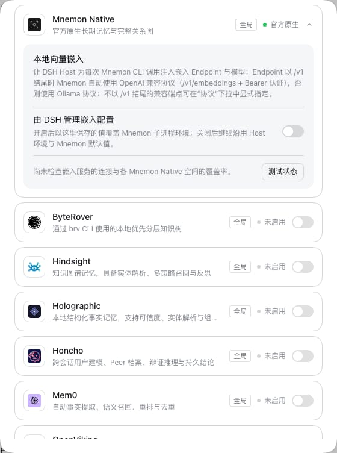
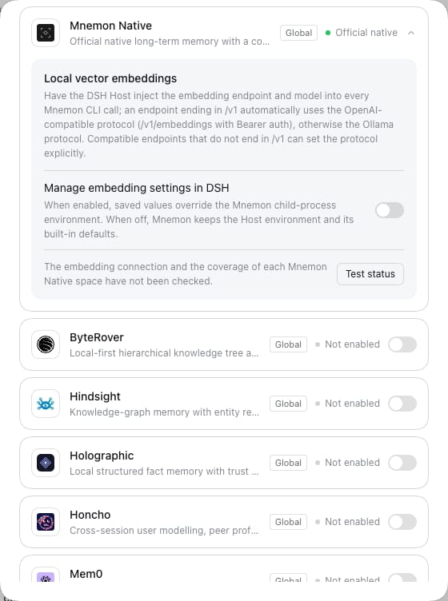
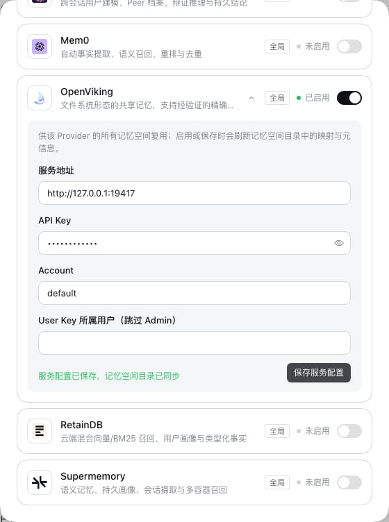
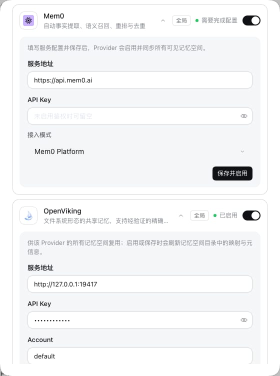
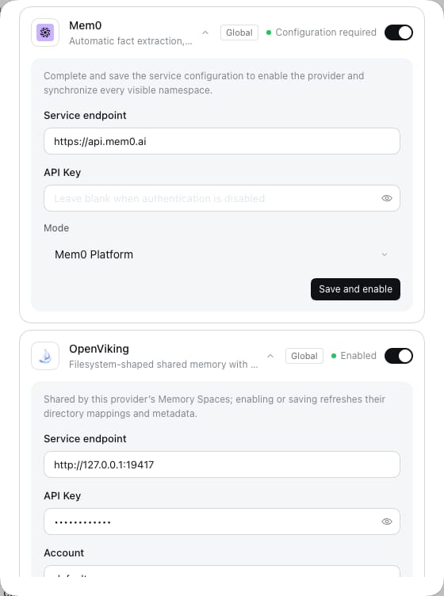

# Memory Spaces owns its settings and its copy

[简体中文](./README.zh-CN.md)

The Starter drew Memory Spaces' settings for it: the Provider list, the embedding settings only Mnemon Native reads and the Mnemon Native row lived in `src/client`, together with 122 entries of Memory Spaces' copy, so Memory Spaces could not change its own settings without a dsh-mnemon release. `ProviderIcon` and the Provider label helpers existed twice, and two field forms were built from the same Provider descriptor. This change gives Memory Spaces its settings and its copy, draws every Provider field with one component and keeps one settings interface whichever versions of the two packages a profile runs. Nothing a user sees or does changes: the settings, Memory Spaces' dialogs and its source lists render as on `main`, pixel for pixel and element for element. Three differences the audit found are left as they are, for later ([Left for later](#left-for-later)).

Tested revision: the branch `claude/spaces-owns-settings`, on top of `main` (`3b33e07e`, v0.5.31), on 2026-10-17 with Node 24.19.0 and pnpm 10.13.1, against the pinned DSH 0.2.1-rc.1 and the installed 0.2.0-rc.2.

## What changes

**Copy.** 122 keys move from `src/client/locales.ts` into Memory Spaces' `presentation/locales.json`, with their text unchanged: 40 that only its pages use (eleven `common.*` keys, `card.*` and `readSources.*`) and 82 that only its settings use (`config.provider*`, `config.embedding*`, `config.native*`, `spaces.offNote`, `common.inactive` and the rest). The Starter merges that file into its dictionaries as before, so `MnemonKey` and both dictionaries keep every key: the copy fingerprint in `tests/fixtures/presentation-baseline.json` does not move (1,341 keys in each language, the same SHA-256), because it is taken over the merged dictionaries. Memory Spaces reads its own copy first and then dsh-mnemon's, with the same interpolation, so every text, and a missing one, comes out as before. Three of the moved settings keys were already unused on `main` (`config.providersSpacesOn`, `config.providersSpacesOffTitle`, `config.providersSpacesOffDetail`, left by an earlier settings layout); they stay, since a public key type does not lose keys.

**Settings.** The Provider list, the embedding settings and the Mnemon Native row move into the Memory Spaces client (`src/client/settings.tsx`, `provider-settings.tsx`) with the single remaining `ProviderIcon` and Provider label helpers. Memory Spaces registers them from its own `apply()` with `installMemoryComponentUI`, as an installed component registers settings. They read the same configuration keys and call the same Host operations as before, with the same RPC names and payloads, through `host`, which the page lends them (below).

**One field.** `ProviderField` (`src/client/provider-field.tsx`) draws every Provider field, the service fields on the configuration page and a space's fields in Memory Spaces' dialogs, in place of the two forms built from the descriptor. It shares the label, the option labels and the input attributes, and draws each place as it was drawn: the configuration page keeps its classes, its checkbox with the label beside it, its button that shows what is typed and its mask for a saved credential; the dialogs keep theirs, the label above, the note that an empty field keeps a saved credential and the choice to clear it. The two places handle a saved credential differently, and one rule for both would change what one of them shows, so each keeps its own.

**What the page lends.** Settings that need dsh-mnemon's configuration or Host operations receive `host`, only for the components dsh-mnemon serves, today Memory Spaces. `host.configuration` reads the keys lent to the component (`embedding`, `storageScope`, `writeEnabled`) and writes only the one it owns, `embedding`, through the page's revision-fenced settings write. `host.operations.read`/`write` call the five operations served to it (`status-summary`, `embedding-status`, `provider-services`, `embedding-fill`, `provider-service-update`) in the page's conversation and workspace, refusing any other. `host.changed()` has the Memory System read its pages again. As with a Source page's `management` client, neither the settings service nor the transport is handed over, and one host serves a component per conversation and workspace, so the settings' effects and the Provider list's cache see the same object.

**For plugin authors.** `dsh-mnemon/client` adds `fallback` to `installMemoryComponentUI` and `MNEMON_COMPONENT_FALLBACK_PRIORITY`, the `host` types, and what the shipped settings are drawn with: `SettingRow`, `SelectRow`, `ToggleRow`, `SettingSelect`, `useLive`, `useStaged`, `PanelActions`, `WriteFailure`, `Callout`, `Reveal`, `GlobalLocationSetting` and `memorySettingsStyles`. Nothing is removed or renamed. The [extension guide](../../en/development/extensions.md#a-components-own-settings-and-status-card) describes them.

**Client declarations stay browser-side.** Exporting the settings controls first made the declarations of `dsh-mnemon/client` reach the Host protocol through the parameter type of an internal hook, `useScope`, and with it the SDK's cordis `Context` augmentation. In a plugin's standalone install that split `Context`, and Documents' standalone typecheck in `verify:plugins` failed with `Context` errors in its tests, while `main` passed. `useScope` is now typed by the shape it reads, the client declarations are browser-side files again (21, against 17 on `main`: the four added are the exported controls), and `scripts/verify-public-entries.mjs`, part of `verify:package`, fails if they reach `src/host/` or `src/sdk/` again.

## One settings interface whichever versions run

A profile can keep its own Memory Spaces, older or newer than the one the Starter pins. DSH keeps one entry per key in a keyed region and refuses a second registration of a key at the same priority; of entries at different priorities it renders the lowest (`@deepseek-ai/dsh-client-ui-slots`, the same in 0.2.0-rc.2 and 0.2.1-rc.1, and DSH's `renderSlot` picks the entry the same way as `renderComponentRegion`). So:

- the Starter registers Memory Spaces' settings with `fallback: true`, at `MNEMON_COMPONENT_FALLBACK_PRIORITY` (100). Memory Spaces' own registration, at the default priority, replaces it while it is registered, and it comes back when that one goes;
- Memory Spaces registers its own only when `dsh-mnemon/client` exports `MNEMON_COMPONENT_FALLBACK_PRIORITY`. Its client bundle is CommonJS loaded through DSH's module loader, so it reads an export the loaded dsh-mnemon lacks as `undefined`. dsh-mnemon 0.5.31 registers its built-in settings at the default priority, so a registration there would be refused, and it lends no `host`.

The fallback is small: one registration of `MemorySpacesSettings`, which the Starter takes from Memory Spaces' public client entry, `dsh-mnemon-source-memory-spaces/client`, as the version it pins has it. The Starter's client build bundles every import, so it resolves that entry through the repository's TypeScript path to the pinned source (`tsdown.config.ts` names it in `alwaysBundle`). Only one module, `src/client/memory-spaces-client.ts`, imports a component's implementation; it also gives the Status page Memory Spaces' `ProviderIcon`, whose Provider list is still the Starter's. `tests/plugin-repository-boundary.spec.ts` allows that module and nothing else. A copy kept in the Starter instead would have kept the duplicated files this change removes. The fallback shows only beside a Memory Spaces of 0.5.21 or earlier, so the settings Memory Spaces brings must keep working against those versions for as long as the Starter keeps it; they use the same five operations those versions answer.

| Starter | Memory Spaces | Registered for Memory Spaces | Shows | WebUI, DSH 0.2.1-rc.1 and 0.2.0-rc.2 |
|---|---|---|---|---|
| this branch | this branch | its own (priority 0) and the Starter's fallback (100) | its own | 1 interface, no console error |
| this branch | 0.5.21 | the Starter's fallback | the fallback, drawn by the code of the pinned Memory Spaces | 1 interface, no console error |
| 0.5.31 | this branch | the 0.5.31 built-in; Memory Spaces registers none | the 0.5.31 built-in | 1 interface, no console error |
| 0.5.31 | 0.5.21 | the 0.5.31 built-in | as before | 1 interface, no console error |

`tests/client-component-fallback.spec.tsx` builds each row in DSH's own `SlotCore` from the registration shapes each version uses: the 0.5.31 Starter registers at the default priority and its `dsh-mnemon/client` lacks `MNEMON_COMPONENT_FALLBACK_PRIORITY`, and Memory Spaces 0.5.21 registers no settings. It checks which entry DSH renders, that exactly one Memory Spaces settings interface renders, that the fallback returns when Memory Spaces' own registration goes, and that DSH refuses Memory Spaces' registration beside the 0.5.31 built-in, which is why it checks first. `test:installed-dsh` runs it against 0.2.0-rc.2's slot core too. Memory Spaces' own `tests/settings.spec.tsx` checks that its `apply()` registers its settings with a dsh-mnemon that yields them and none with one that does not.

The WebUI column comes from the e2e fixture with the published `dsh-mnemon@0.5.31` and `dsh-mnemon-source-memory-spaces@0.5.21` client bundles put in place of this branch's (`lib/client.js` only; the Host stayed this branch's), on both DSH releases. In each of the eight runs, the Memory Spaces page under Plugins showed one **Memory providers** heading, one Mnemon Native card and one OpenViking row, opened the OpenViking form with the same four fields, and logged no console error.

## Before and after

Headless Chrome, 1280×800, light, in the e2e fixture on DSH 0.2.1-rc.1: `main` (`3b33e07e`) built in a separate worktree, and this branch, in both languages. Each run opened Memory Spaces' page under Plugins, Mnemon Native's embedding settings, OpenViking's form before and after typing and once saved with a credential (against the repository's OpenViking protocol fixture, `scripts/fixtures/openviking-protocol.mjs`, with a placeholder key), Mem0's form (a choice and a credential) and ByteRover's (a path, its location row and a credential), DSH's own page for the Memory Spaces row, and the Memory Spaces page's **Create Memory Space** dialog with OpenViking's fields. Every view below is the same on `main` and on this branch.

| View | `main` and this branch |
|---|---|
| Memory Spaces' page under Plugins, Chinese |  |
| The same, English |  |
| Mnemon Native opened to its embedding settings, Chinese |  |
| The same, English |  |
| OpenViking saved with a credential, which the field shows as a mask, Chinese |  |
| The same, English |  |
| Mem0's form: a choice, and a credential field with its hint, Chinese |  |
| The same, English |  |

- Pixels: all nine views identical in both languages but one: the Create Memory Space dialog showed 21 (Chinese) and 11 (English) pixels one level apart in one channel, at DSH's close icon and, in Chinese, two corner pixels. A second capture of this branch in Chinese differs from its first at the same pixels and matches `main` in all nine views.
- Layout: the box, text and computed styles of every element under the settings, and of the dialog's Provider fields, are identical.
- Markup: the settings' markup, with the build-specific prefix of class names removed, is identical in all eight settings views in both languages.

## Left for later

Behavior changes are out of scope here, so these stay as on `main`:

- **A Provider without `readSources.model.<provider>` text** renders an empty line under its space in the Memory Spaces pages' source lists. Memory Spaces has the text for the nine Providers it ships with; any other Provider could read as its descriptor's label instead.
- **Two rules for a saved credential.** The configuration page fills the field with twelve dots; typing over the selected mask replaces it, but an edit that keeps part of it, such as moving the cursor and deleting one dot, saves the remaining dots as the credential. It would also show a saved credential if a Host sent one (`secretValues`; dsh-mnemon's never does). Memory Spaces' dialogs leave the field empty, say the credential is saved and kept when the field is left empty, and offer clearing it. The dialogs' rule is the safer one to settle on.
- **`.providerFieldControl` is styled twice, differently**: the configuration page's (`MnemonSettingsCard.module.css`) stacks the field at the bottom of a column and gives its checkbox no margin; the page kit's (`MnemonView.module.css`, also what Memory Spaces 0.5.21's dialogs use) is a grid whose checkbox has 2 px vertical margins. They are not copies: merging them changes where a field sits in a cell taller than it and how a checkbox is sized, so both stay.

## Compatibility

- **Profiles that pin their own Memory Spaces:** the table above. A Memory Spaces newer than this one replaces the fallback with its own settings, as this one does.
- **Public SDK:** additions only, listed above. The removed `MnemonClient` methods and the deleted `src/client` files were never public entries. Memory Spaces' client entry adds `MemorySpacesSettings`, `installMemorySpacesSettings` and `ProviderIcon`.
- **Peer floor:** Memory Spaces' settings use the new `dsh-mnemon/client` exports. It checks for them at run time, so it keeps working with an older Starter, but the release PR should raise its `dsh-mnemon` peer floor to the release that exports `MNEMON_COMPONENT_FALLBACK_PRIORITY`.
- **Stored data and Host:** no setting, key, RPC name, payload or tool changes; the Host is untouched. `tests/client-component-host.spec.ts` checks the RPC names and payloads the moved settings send.
- **Styles:** no style rule changes. The moved settings use the configuration's class map from `dsh-mnemon/client`, so the Starter still owns those rules, and the dialogs keep the page kit's.
- **Copy:** an older Starter beside this Memory Spaces still has every key in its own dictionary; Memory Spaces reads its own copy first.

## Checks

| Command | Result |
|---|---|
| `pnpm run typecheck`; `pnpm --filter dsh-mnemon-source-memory-spaces run typecheck` | passed |
| `pnpm run test:root` | 2,049 passed, 6 skipped (140 files) |
| `DSH_HOST_ROOT=<installed 0.2.0-rc.2> pnpm run test:installed-dsh` | 2,049 passed, 6 skipped (140 files) |
| `pnpm --filter dsh-mnemon-source-memory-spaces run test` | 260 passed, 2 skipped (24 files) |
| `pnpm run verify` | passed in 123 s: 4,356 links and 225 anchors, a deterministic build of 53 files, 17 plugin suites with 547 passed and 3 skipped, the root suite as above, Headless, a package of 63 files and 21 browser-side client declarations |
| `MNEMON_CLI_PATH=/nonexistent/mnemon MNEMON_PLUGIN_VERIFY_CONCURRENCY=1 pnpm run verify:plugins` | passed in 245 s: 17 independent plugin repositories and 18 packed artifacts |
| `pnpm run release:intent` (base `3b33e07e`) | passed: changeset coverage for `dsh-mnemon` and `dsh-mnemon-source-memory-spaces` |

New tests: `tests/client-component-fallback.spec.tsx` (the four rows), `tests/client-component-host.spec.ts` (what `host` lends and refuses, and the RPC names and payloads, moved from `tests/client-api.spec.ts` with the client methods), and Memory Spaces' `tests/settings.spec.tsx` (the field as each place draws it, including both credential rules, its own settings over a lent `host`, registration by dsh-mnemon version). The existing settings tests in `tests/client-settings.spec.tsx` render Memory Spaces' settings over the host the Starter lends and pass with their assertions unchanged.
